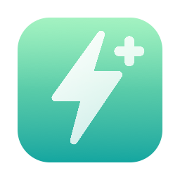
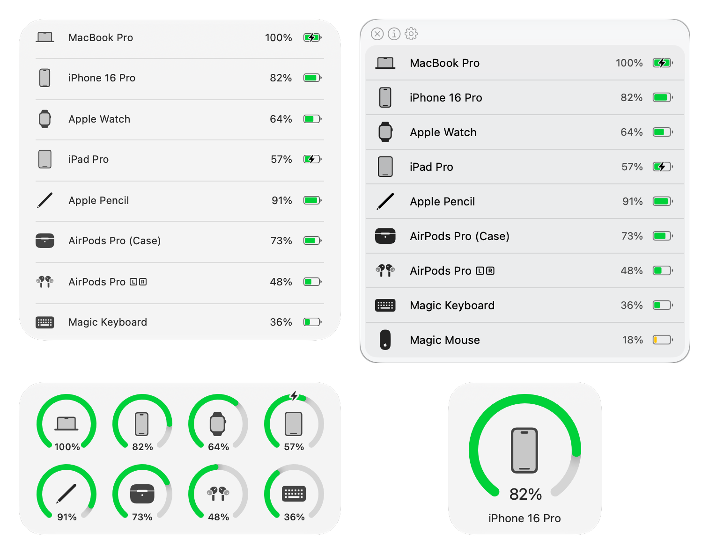

# 

<h1 align="center">AirBattery Plus</h1>
<h3 align="center">La batterie de tous vos appareils, dans la barre des menus, le Dock et les widgets de votre Mac. <a href="./README.md">[English]</a> <a href="./README_zh.md">[中文版本 (app d'origine)]</a></h3>

> [!NOTE]
> **AirBattery Plus est un fork maintenu d'[AirBattery](https://github.com/lihaoyun6/AirBattery), de [lihaoyun6](https://github.com/lihaoyun6).** L'original n'a plus eu de nouvelle version depuis juin 2025. Ce fork corrige des plantages, le garde compatible avec macOS 26 et 27, et reprend des correctifs de la communauté. Il fonctionne à côté de l'app officielle sans partager ses réglages.

<picture>
  <source media="(prefers-color-scheme: dark)" srcset="./img/preview_dark.png">
  <source media="(prefers-color-scheme: light)" srcset="./img/preview.png">
  
</picture>

## Fonctions

- **Ce Mac**, **iPhone, iPad et Apple Watch** (en USB, Wi-Fi ou Bluetooth), **Apple Pencil**, **AirPods et Beats**, **Magic Keyboard, Mouse et Trackpad** et beaucoup d'autres **accessoires Bluetooth**.
- Dans la **barre des menus**, le **Dock** ou des **widgets**, dans l'ordre de votre choix, avec des appareils épinglés dans la barre des menus.
- **Alertes de batterie** quand un appareil est presque vide ou a fini de charger.
- **Nearcast** : la batterie de vos autres Mac et de leurs appareils, chiffrée sur votre réseau local.
- Outil en ligne de commande **`abtp`**, avec sortie JSON et CSV.
- **Mises à jour intégrées**, signées par le projet. Aucune statistique d'usage : le seul accès à internet de l'app est la recherche de mises à jour ([Confidentialité](docs/guide/fr/permissions-privacy.md)).
- Interface Liquid Glass sur macOS 26 et plus récent.

## Installation

macOS 12 ou plus récent. Téléchargez le DMG sur la [page des versions](../../releases), ouvrez-le et glissez **AirBattery Plus** dans Applications. L'app n'est pas notarisée : au premier lancement, autorisez-la dans **Réglages Système › Confidentialité et sécurité**. Pas à pas : [Prise en main](docs/guide/fr/getting-started.md).

## Documentation

- [Guide d'utilisation](docs/guide/fr/README.md) : appareils pris en charge, réglages, Nearcast, `abtp`, dépannage.
- [Journal des modifications](CHANGELOG.md) (en anglais).
- [Contribuer](CONTRIBUTING.md) (en anglais) : compiler l'app, la traduire, signaler un bogue.

## Crédits

**[AirBattery](https://github.com/lihaoyun6/AirBattery)**, de [@lihaoyun6](https://github.com/lihaoyun6), est l'app d'origine sur laquelle repose ce fork ([page d'accueil](https://lihaoyun6.github.io/airbattery/)). Son auteur accepte les dons :

Contributions reprises du projet d'origine et de sa communauté :
- [#216](https://github.com/lihaoyun6/AirBattery/pull/216) de [@R0cketBean](https://github.com/R0cketBean) : correctif d'un plantage à la sortie de veille.
- [#214](https://github.com/lihaoyun6/AirBattery/pull/214) de [@Moyuin-aka](https://github.com/Moyuin-aka) : connexions Bluetooth limitées aux iPhone et iPad que vous autorisez.
- [#161](https://github.com/lihaoyun6/AirBattery/pull/161), [#162](https://github.com/lihaoyun6/AirBattery/pull/162), [#163](https://github.com/lihaoyun6/AirBattery/pull/163) de [@barkleesanders](https://github.com/barkleesanders) et [#177](https://github.com/lihaoyun6/AirBattery/pull/177) de [@leo1425](https://github.com/leo1425), fusionnées dans l'original après la 1.6.3 mais jamais publiées.
- [@callieskye](https://github.com/callieskye) ([Air-Battery](https://github.com/callieskye/Air-Battery), version communautaire 1.6.5) : de nombreux correctifs, repris un par un (détails dans [docs/dev/UPSTREAM.md](./docs/dev/UPSTREAM.md), en français).

Bibliothèques et outils :
- [libimobiledevice](https://github.com/libimobiledevice/libimobiledevice) @libimobiledevice : les outils qui lisent l'iPhone, l'iPad et l'Apple Watch sont compilés à partir de libimobiledevice 1.4.0 et de ses bibliothèques associées par [`scripts/build-libimobiledevice.sh`](./scripts/build-libimobiledevice.sh). Leurs licences sont dans `AirBattery/libimobiledevice/licenses/`.
- [comptest](https://gist.github.com/nikias/ebc6e975dc908f3741af0f789c5b1088) @nikias : l'outil qui lit l'Apple Watch est compilé à partir de ce code, avec un correctif de plantage ([`scripts/libimobiledevice/comptest.c`](./scripts/libimobiledevice/comptest.c)).
- [MultipeerKit](https://github.com/insidegui/MultipeerKit) @insidegui : communication entre Mac sur le réseau local (Nearcast).
- [swift-argument-parser](https://github.com/apple/swift-argument-parser) @apple : l'outil en ligne de commande `abtp`.

Le projet d'origine indique qu'une partie de son code a été générée ou remaniée par [ChatGPT](https://chat.openai.com).

## Licence

[AGPL-3.0](./LICENSE), comme l'original. Si vous redistribuez AirBattery Plus ou une version modifiée, son code source doit être disponible sous la même licence.
